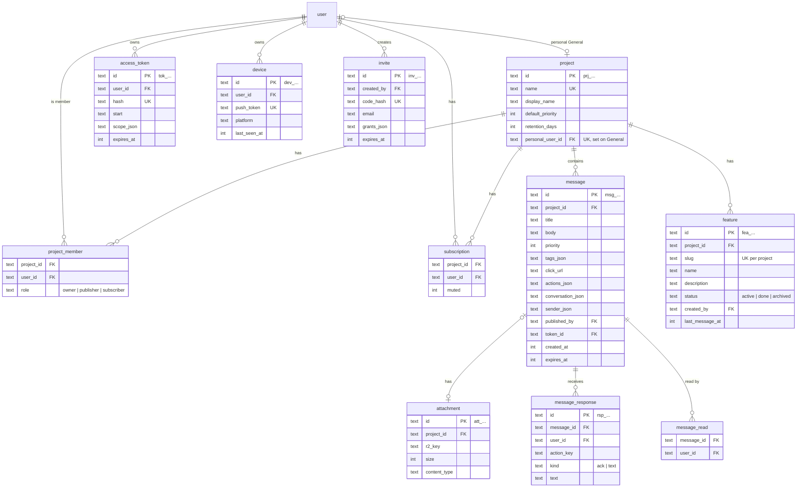

The better-auth tables (`user`, `session`, `account`, `verification`) already exist in `packages/db/src/schema/auth.ts`. v1 adds the tables below. The OAuth tables for MCP sign-in (`jwks`, `oauth_client`, `oauth_access_token`, `oauth_refresh_token`, `oauth_consent`, `oauth_resource`, `oauth_client_resource`, `oauth_client_assertion`) are in `packages/db/src/schema/oauth.ts`; better-auth owns them.

## Notes

- **IDs.** notifier IDs are `<prefix>_<26 lowercase base32 chars>`, for example `msg_01jd8x5k2m9q7r4t6v8w0y3z5a`. The characters are a ULID, so IDs sort by creation time and work as pagination cursors. User IDs come from better-auth. The prefixes are defined in `ID_PREFIXES` in `packages/contract/src/common.ts`.
- **Project names** are unique across the deployment, because they appear in publish URLs. <Status kind="open" />
- **Time** is stored as Unix milliseconds in integer columns, like the existing auth tables, and exposed as ISO-8601 strings in the API.
- **JSON columns** (`tags_json`, `actions_json`, `conversation_json`, `sender_json`, `scope_json`, `grants_json`) are validated with the contract's zod schemas on write and on read. D1 has no JSON column type.
- **Integrity.** Enum-like columns (`role`, `kind`, `platform`) and `message.priority` have SQL `CHECK` constraints, and `access_token.hash` must be 64 lowercase hex characters, so bad rows fail in the database too.
- **Project → Feature → Notification.** `project.personal_user_id` marks a user's private General project; a unique index allows one per user. A `feature` belongs to one project, and its `slug` (lowercase `[a-z0-9][a-z0-9-]{0,62}`, checked in SQL too) is the `conversation.id` of its messages, so a feature's thread is conversation key `c:<slug>`. Messages without a conversation form the project-level thread, key `p:<project id>`. Deleting a project deletes its features.
- **Topics removed.** Projects used to be called topics. Migration `20261120213814_remove_topics` renamed the tables and columns, rewrote ids from `top_` to `prj_`, conversation keys from `t:` to `p:`, and the project ids and names inside invite grants and token scopes.
- **Read state** is one row per user and message in `message_read`. Unread counts come from messages in the user's projects with no row for that user.
- **Indexes.** `message (project_id, id desc)` for history, `message (expires_at)` for cleanup, `device (user_id)`, `project_member (user_id)`.
- **Deleting.** Removing a project cascades to members, subscriptions, messages, reads and responses. Attachment files in R2 are deleted by the retention job, not inside the request.
