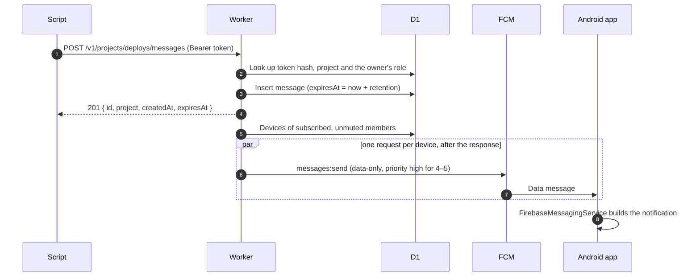
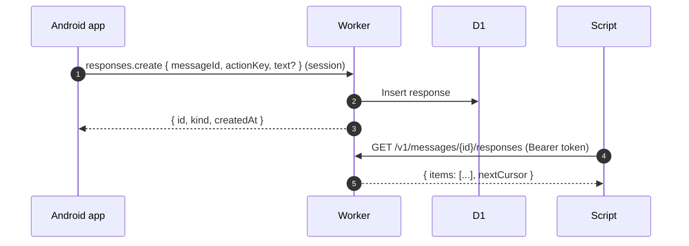
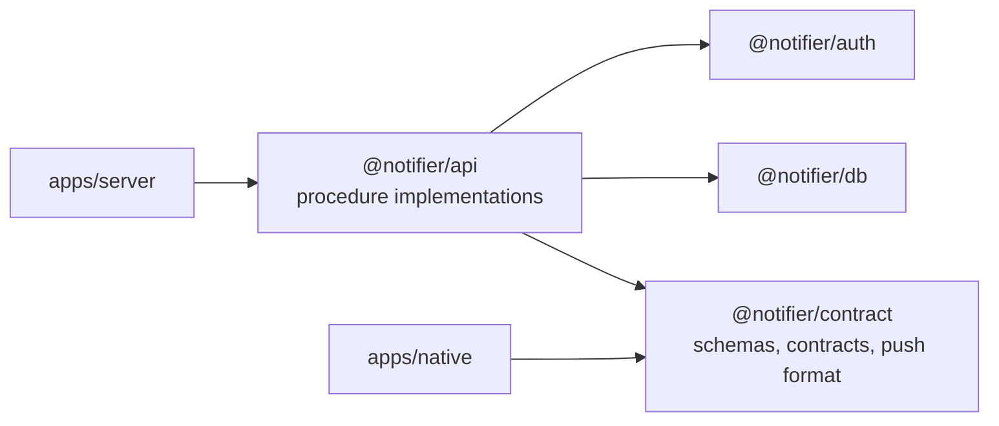

## Components

| Piece | Runs on | Job |
| --- | --- | --- |
| `apps/server` | Cloudflare Worker (Hono), routes `notifier.bartuozel.com/api/*` and `/.well-known/*` | Public API at `/api/v1`, app API at `/api/rpc`, auth at `/api/auth`, MCP at `/api/mcp`, FCM sender, retention cron |
| `apps/fumadocs` | Cloudflare Worker with static assets, custom domain `notifier.bartuozel.com` | This docs site, at the root |
| `apps/native` | Android (Expo, development build) | Inbox, projects, settings; receives FCM and builds notifications |
| D1 | Cloudflare | Users, projects, members, messages, tokens, devices, responses |
| R2 | Cloudflare | Attachment files <Status kind="open" /> |
| FCM | Google | Delivers data-only messages to Android devices |

Infrastructure is declared in `packages/infra/alchemy.run.ts`. v1 adds an R2 bucket, a Cron Trigger and the FCM service account secret to the server Worker.

## Publishing a message

The response goes back before the fan-out. The Worker sends pushes in `ctx.waitUntil()`, so a slow FCM call never delays the publisher.

<Callout type="warn" title="Fan-out limits">
  A Worker invocation has a limit on outgoing requests, so fan-out happens in one `waitUntil` only while a project has few devices. Beyond that, sending moves to a Cloudflare Queue. With a small invited group, v1 stays well under the limit, and the switch point is a constant in the sender.
</Callout>

## Replying from a notification

The reply goes over the app API, using the session the app already stores. Android lets the notification send it in the background without opening the app.

## Repository boundaries

`@notifier/contract` depends only on `zod` and `@orpc/contract`, so the apps can import it without pulling in server code.
