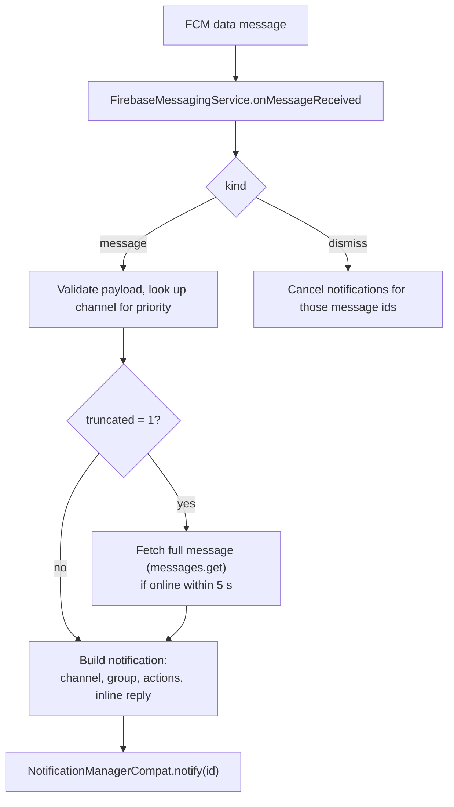

<Status kind="decided" /> The Worker sends to **FCM HTTP v1** itself. There is no Expo push service or other relay in between.

## Why data-only messages

FCM has two kinds of message:

| | Notification message | Data-only message |
| --- | --- | --- |
| Who draws the notification | The Android system, when the app is in the background | The app, always |
| Channel per priority | Only the channel ID | ✓ |
| Grouping per topic | Limited | ✓ |
| Action buttons and inline reply | ✗ | ✓ |
| Dismiss on other devices | ✗ | ✓ |

notifier needs everything in the right-hand column, so every push is data-only and the app builds the notification itself.

## Sending from the Worker

<Steps>
<Step>

### Get an OAuth token

Sign a JWT with the Firebase service account key using WebCrypto (`RS256`), and exchange it at `https://oauth2.googleapis.com/token` for an access token with the `firebase.messaging` scope. Cache it in memory until shortly before it expires; it lasts about an hour.

</Step>
<Step>

### Send one request per device

```http
POST https://fcm.googleapis.com/v1/projects/<project-id>/messages:send
Authorization: Bearer <oauth-token>
Content-Type: application/json

{
  "message": {
    "token": "<device push token>",
    "data": { "v": "1", "kind": "message", "id": "msg_...", "...": "..." },
    "android": { "priority": "HIGH", "ttl": "86400s" }
  }
}
```

`data` follows the [push payload contract](/docs/api/push-payload).

</Step>
<Step>

### Handle the response

| FCM response | Action |
| --- | --- |
| `200` | Done |
| `404 UNREGISTERED`, `400 INVALID_ARGUMENT` on the token | Delete the device row |
| `429` or `5xx` | Retry with backoff, at most 3 tries |

</Step>
</Steps>

**FCM priority.** Messages with priority 4–5 are sent as `HIGH` so they wake the phone right away. Priority 1–3 are sent as `NORMAL`, and Android may hold them back a little to save battery.

**Secrets.** The service account JSON is stored as the Worker secret `FCM_SERVICE_ACCOUNT` and never committed. The project ID is read from it.

## Receiving on Android

The app has to build the notification even when it is not running.

<Status kind="decided" /> A small Kotlin module in `apps/native/modules/notifier-push` handles it. It contains a `FirebaseMessagingService` whose `onMessageReceived`:

1. parses the payload,
2. picks the priority channel,
3. draws or loads the conversation and sender avatars,
4. sets the group and actions,
5. posts the notification natively.

No JavaScript has to start, which keeps it reliable when the app has been killed. The module also creates the five channels on first launch and forwards `onNewToken` to the app for device registration.

`expo-notifications` with a background task was the alternative. It was rejected because it needs a headless JS runtime for every push, and building chat-style notifications from JavaScript is limited.



## Device tokens

- The app registers the raw FCM token from `getDevicePushTokenAsync()` with `devices.register` on every launch and whenever `onNewToken` fires. Registration upserts by token.
- Signing out calls `devices.remove` for the current device. Without that, the phone would keep getting the previous user's pushes.
- Devices not seen for 60 days are deleted by the [retention job](/docs/architecture/retention).

## iOS

Not in v1. FCM can also deliver to iOS through APNs, so the sender may be reused, but a data-only message on iOS needs a Notification Service Extension to change the content. That will be decided when iOS work starts. <Status kind="open" />
