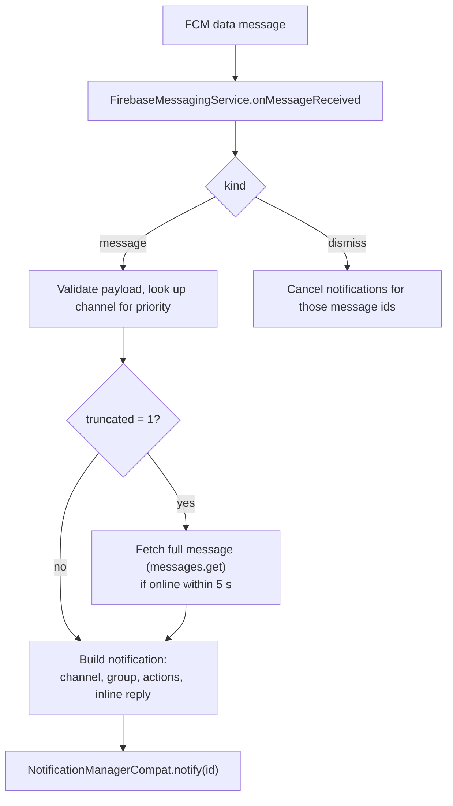

<Status kind="decided" /> The Worker sends to **FCM HTTP v1** itself. There is no Expo push service or other relay in between.

## Why data-only messages

FCM has two kinds of message:

| | Notification message | Data-only message |
| --- | --- | --- |
| Who draws the notification | The Android system, when the app is in the background | The app, always |
| Channel per priority | Only the channel ID | ✓ |
| Grouping per topic | Limited | ✓ |
| Action buttons and inline reply | ✗ | ✓ |
| Dismiss on other devices | ✗ | ✓ |

notifier needs everything in the right-hand column, so every push is data-only and the app builds the notification itself.

## Sending from the Worker

<Steps>
<Step>

### Get an OAuth token

Sign a JWT with the Firebase service account key using WebCrypto (`RS256`), and exchange it at `https://oauth2.googleapis.com/token` for an access token with the `firebase.messaging` scope. Cache it in memory until shortly before it expires; it lasts about an hour.

</Step>
<Step>

### Send one request per device

```http
POST https://fcm.googleapis.com/v1/projects/<project-id>/messages:send
Authorization: Bearer <oauth-token>
Content-Type: application/json

{
  "message": {
    "token": "<device push token>",
    "data": { "v": "1", "kind": "message", "id": "msg_...", "...": "..." },
    "android": { "priority": "HIGH", "ttl": "86400s" }
  }
}
```

`data` follows the [push payload contract](/docs/api/push-payload).

</Step>
<Step>

### Handle the response

| FCM response | Action |
| --- | --- |
| `200` | Done |
| `UNREGISTERED` error code, or `400 INVALID_ARGUMENT` on the token | Delete the device row |
| `401` | Get a new access token and try once more |
| `429`, `5xx` or a network error | Retry with backoff (200 ms, 400 ms, or `Retry-After` capped at 2 s), at most 3 tries |
| Anything else, including a bare `404` | Log it and keep the device |

A bare `404` without `UNREGISTERED` usually means a wrong project ID, so it never deletes devices.

</Step>
</Steps>

**Fan-out.** On publish, the Worker sends to every Android device of users who are members of the topic and subscribed to it without muting, the publisher included. Up to 6 requests run at once, inside `executionCtx.waitUntil`, so the publish response never waits for FCM. Dead devices are deleted in one statement at the end.

**FCM priority.** Messages with priority 4–5 are sent as `HIGH` so they wake the phone right away. Priority 1–3 are sent as `NORMAL`, and Android may hold them back a little to save battery. `dismiss` pushes are always `NORMAL`.

**Dismiss.** When `messages.markRead` marks messages as read, the Worker sends `dismiss` with only the newly marked ids to all of that user's Android devices. The API does not know which device the read came from, so the reading device gets it too, which is harmless.

**Secrets.** The service account JSON is stored as the Worker secret `FCM_SERVICE_ACCOUNT` and never committed. The project ID is read from it. The secret is optional: without a usable one, push is disabled, publishing still works, and each request logs `push disabled` at debug level.

**Code.** The sender, payload builder, fan-out and dispatch live in `packages/api/src/push/`. They take `fetch`, the clock and the database as inputs, so they are tested in Node with no Workers globals. `apps/server/src/dispatch.ts` connects them to `waitUntil` and gives each background task its own logger, because the request's log has usually been emitted by the time the push runs.

## Receiving on Android

The app has to build the notification even when it is not running.

<Status kind="decided" /> A small Kotlin module in `apps/native/modules/notifier-push` handles it. It contains a `FirebaseMessagingService` whose `onMessageReceived`:

1. parses the payload,
2. picks the priority channel,
3. draws or loads the conversation and sender avatars,
4. sets the group and actions,
5. posts the notification natively.

No JavaScript has to start, which keeps it reliable when the app has been killed. The module also creates the five channels on first launch and forwards `onNewToken` to the app for device registration.

`expo-notifications` with a background task was the alternative. It was rejected because it needs a headless JS runtime for every push, and building chat-style notifications from JavaScript is limited.



## Device tokens

- The app registers the raw FCM token from `getDevicePushTokenAsync()` with `devices.register` on every launch and whenever `onNewToken` fires. Registration upserts by token.
- Signing out calls `devices.remove` for the current device. Without that, the phone would keep getting the previous user's pushes.
- Devices not seen for 60 days are deleted by the [retention job](/docs/architecture/retention).

## iOS

Not in v1. The server only pushes to devices registered as `android`: an iOS device token is an APNs token, which FCM would reject, and the device would then be deleted as dead. FCM can also deliver to iOS through APNs, so the sender may be reused, but a data-only message on iOS needs a Notification Service Extension to change the content. That will be decided when iOS work starts. <Status kind="open" />
