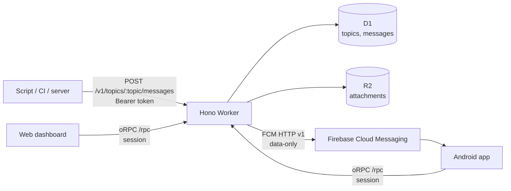

Pocket Notifier is a notification service in the spirit of [ntfy](https://ntfy.sh): anything that can make an HTTP request can send a message to a **topic**, and everyone subscribed to that topic gets a push notification on their phone.

It runs on your own Cloudflare account, is shared with a small group of invited people, and uses its own API rather than ntfy's.

```bash title="Publish a message"
curl https://notifier.example.com/v1/topics/deploys/messages \
  -H "Authorization: Bearer nt_..." \
  -H "Content-Type: application/json" \
  -d '{"title":"Prod deploy finished","body":"v1.42.0 is live","priority":4}'
```

## How it fits together



## Status

This documentation is the specification for v1. Nothing beyond the starter template is built yet.

Every design point is labelled:

- <Status kind="decided" /> agreed and ready to build.
- <Status kind="open" /> a proposal that still needs a decision.
- <Status kind="later" /> deliberately out of v1.

The [decision log](/docs/decisions) lists them all in one place.

## Where things live

<Files>
  <Folder name="apps" defaultOpen>
    <File name="server/ — Hono Worker: public API, app API, push sender" />
    <File name="web/ — Next.js dashboard" />
    <File name="native/ — Expo app, Android first" />
    <File name="fumadocs/ — these docs" />
  </Folder>
  <Folder name="packages" defaultOpen>
    <File name="contract/ — API contracts and wire formats (source of truth)" />
    <File name="api/ — procedure implementations" />
    <File name="auth/ — better-auth setup" />
    <File name="db/ — Drizzle schema for D1" />
    <File name="infra/ — Alchemy stack (Workers, D1, R2)" />
  </Folder>
</Files>

<Callout title="The contract is the source of truth">
  Request and response shapes, limits and error codes are defined in code in `packages/contract`. These pages explain behaviour and the reasons behind it; when a page and the contract disagree, the contract wins and the page needs fixing.
</Callout>

<Cards>
  <Card title="Scope" href="/docs/product/scope" description="What v1 does and does not do" />
  <Card title="Publish API" href="/docs/api/publish" description="Send a message from a script" />
  <Card title="Android notifications" href="/docs/mobile/notifications" description="Channels, grouping, actions, inline reply" />
  <Card title="Roadmap" href="/docs/product/roadmap" description="Milestones and estimates" />
</Cards>
